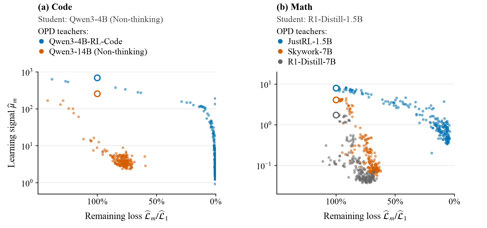

<div align="center">


<h1>Why On-Policy Distillation Sometimes Fails:<br>Vanishing Learning Signals</h1>

<p>
Lei Zhao<sup>1,*</sup> · Qichao Zhao<sup>2,*</sup> · Bowen Zuo<sup>3</sup> · Qishi Zhan<sup>4</sup>
</p>
<p>
 <sup>1</sup>University of Pennsylvania &nbsp;&nbsp;  <sup>2</sup>Tsinghua University<br>
 <sup>3</sup>University of California, Riverside &nbsp;&nbsp;  <sup>4</sup>Marquette University
</p>
<p><sup>*</sup>Equal contribution</p>

<p>
<a href="https://arxiv.org/abs/2610.11247"></a>
<a href="https://leizhao7.github.io/opd-learning-signals/"></a>
<a href="https://huggingface.co/collections/leizhao7/opd-learning-signals-6adf7a79a2ccaa4deb1a2d02"></a>
<a href="https://github.com/leizhao7/opd-learning-signals/actions/workflows/checks.yml"></a>
<a href="LICENSE"></a>

</p>

<p>
<a href="https://leizhao7.github.io/opd-learning-signals/">🌐 Project website</a> &nbsp;•&nbsp;
<a href="https://arxiv.org/abs/2610.11247">📄 Paper</a> &nbsp;•&nbsp;
<a href="#-news">🎉 News</a> &nbsp;•&nbsp;
<a href="#-findings">🔍 Findings</a> &nbsp;•&nbsp;
<a href="#-results">📊 Results</a> &nbsp;•&nbsp;
<a href="#-checkpoints">🤗 Checkpoints</a> &nbsp;•&nbsp;
<a href="#-quick-start">🚀 Quick start</a> &nbsp;•&nbsp;
<a href="docs/EXPERIMENTS.md">🧪 Experiments</a> &nbsp;•&nbsp;
<a href="docs/REPRODUCIBILITY.md">🔁 Reproducibility</a> &nbsp;•&nbsp;
<a href="#-citation">📌 Citation</a>
</p>

</div>

**Watch the 58-second overview**

https://github.com/user-attachments/assets/dc8e687d-cdf7-4a62-abaa-8a52c2c35e47

**Why can on-policy distillation (OPD) stall while the student still differs substantially from its teacher?** We study OPD for code generation and mathematical reasoning. We combine training diagnostics with a continuous-time analysis. This repository contains the training recipes, analysis tools and numerical inputs for the paper's figures. The figures rebuild on a CPU without any model download.

## 🎉 News

- **[2026-10-26]** 🤗 All seven step-200 student checkpoints are on Hugging Face ([collection](https://huggingface.co/collections/leizhao7/opd-learning-signals-6adf7a79a2ccaa4deb1a2d02)); see [Checkpoints](#-checkpoints).
- **[2026-10-26]** 🌐 The [project website](https://leizhao7.github.io/opd-learning-signals/) is live, with interactive training curves.
- **[2026-10-18]** Every training recipe now lists the loss reduction it reached in the paper ([experiment map](docs/EXPERIMENTS.md#expected-results)), so you can check your own run against it.
- **[2026-10-08]** Paper released on [arXiv](https://arxiv.org/abs/2610.11247).

## 🔍 Findings

**1. With larger-scale teachers, OPD often plateaus; with self-RL teachers it does not.** Each student is trained for 200 updates.
- With the larger-scale teachers studied, OPD loss stalls while substantial teacher–student differences remain.
- Teachers obtained by further RL training of the student itself (*self-RL teachers*) allow far larger loss reduction and accuracy gains.
- Mean final loss reduction is **25.1%** for the five larger-scale-teacher runs and **96.2%** for the two self-RL runs.

**2. The plateau shows up as a vanishing learning signal.** We track the gradient strength relative to the remaining loss, $\mu = \lVert g\rVert^2 / 2\mathcal{L}$. The key question is how much loss remains as the signal weakens. In the self-RL runs, the loss reaches low values. In the larger-scale-teacher runs, the signal weakens while substantial loss remains.

<a href="docs/assets/learning-signals.png">
  
</a>

*Each dot is one update. Open circles mark step 1. Moving right means less loss remains; moving down means a weaker learning signal.*

**3. Two quantities govern loss decay.** The idealized OPD flow obeys

$$\frac{d\mathcal L}{dt}=-2\mu(1+\alpha)\mathcal L.$$

Here $\alpha$ measures whether the changing rollout distribution reinforces or offsets the gradient step. Under stated regularity conditions, a sufficiently nearby teacher with a shared parameterization gives a local recovery guarantee. The loss is then bounded by an exponentially decaying term plus a residual.

## 📊 Results

Loss and accuracy after 200 OPD updates. Code accuracy is avg@4, macro-averaged over HumanEval+, MBPP+ and LiveCodeBench. Math accuracy is avg@8, macro-averaged over AIME24, AIME25 and AMC23. † marks self-RL teachers.

| Task / student | Teacher | Max loss reduction | Final loss reduction | Accuracy: student → after OPD (teacher) | Gain (pp) | Gap recovery |
|:---|:---|---:|---:|:---:|---:|---:|
| Code / Qwen3-4B (Non-thinking) | Qwen3-4B-RL-Code † | **99.5%** | **99.4%** | 52.7 → 60.4 (62.6) | **+7.70** | **77.4%** |
| | Qwen3-14B (Non-thinking) | 40.5% | 25.9% | 52.7 → 53.4 (58.4) | +0.75 | 13.0% |
| Math / Qwen3-1.7B (Non-thinking) | Qwen3-4B-RL-Math | **65.1%** | **55.4%** | 21.1 → 43.9 (69.2) | **+22.83** | **47.5%** |
| | Qwen3-4B (Non-thinking) | 30.4% | 6.2% | 20.7 → 22.7 (35.1) | +2.07 | 14.3% |
| Math / R1-Distill-1.5B | JustRL-1.5B † | **96.3%** | **92.9%** | 39.9 → 51.9 (56.9) | **+12.03** | **70.7%** |
| | Skywork-7B | 37.7% | 23.9% | 39.9 → 46.1 (70.9) | +6.27 | 20.2% |
| | R1-Distill-7B | 34.3% | 13.9% | 39.9 → 42.7 (57.8) | +2.80 | 15.6% |

<details>
<summary>Metric definitions and caveats</summary>

- **Max loss reduction** is `1 − min loss / step-1 loss`. **Final loss reduction** uses the step-200 loss instead. Both use raw, unsmoothed losses.
- **Gap recovery** is `(accuracy after OPD − base student) / (teacher − base student)`.
- Qwen3-4B-RL-Math is a larger-scale teacher for the 1.7B student, not a self-RL teacher.
- These are descriptive results for the runs studied. They are not a controlled estimate of the effect of teacher size or initialization.

Source data: [`teacher_recoverability_metrics.csv`](paper/figures/data/teacher_recoverability_metrics.csv). See also the [full training curves](docs/assets/teacher-trainability.png) and the [metric conventions](docs/REPRODUCIBILITY.md#rate-and-loss-conventions).

</details>

## 🤗 Checkpoints

We release the **final student of every run in the results table**, saved after 200 OPD updates. All seven are in the 🤗 [OPD Learning Signals collection](https://huggingface.co/collections/leizhao7/opd-learning-signals-6adf7a79a2ccaa4deb1a2d02). Teacher weights are not included.

| Checkpoint | Task | Student | Teacher | Final loss reduction | Accuracy: student → step 200 |
|:---|:---|:---|:---|---:|:---:|
| [Qwen3-4B-OPD-RL-Code-Step200](https://huggingface.co/leizhao7/Qwen3-4B-OPD-RL-Code-Step200) | Code | Qwen3-4B | Qwen3-4B-RL-Code † | **99.4%** | 52.7 → **60.4** |
| [Qwen3-4B-OPD-Qwen3-14B-Step200](https://huggingface.co/leizhao7/Qwen3-4B-OPD-Qwen3-14B-Step200) | Code | Qwen3-4B | Qwen3-14B | 25.9% | 52.7 → 53.4 |
| [Qwen3-1.7B-OPD-RL-Math-Step200](https://huggingface.co/leizhao7/Qwen3-1.7B-OPD-RL-Math-Step200) | Math | Qwen3-1.7B | Qwen3-4B-RL-Math | **55.4%** | 21.1 → **43.9** |
| [Qwen3-1.7B-OPD-Qwen3-4B-Step200](https://huggingface.co/leizhao7/Qwen3-1.7B-OPD-Qwen3-4B-Step200) | Math | Qwen3-1.7B | Qwen3-4B | 6.2% | 20.7 → 22.7 |
| [R1-Distill-Qwen-1.5B-OPD-JustRL-Step200](https://huggingface.co/leizhao7/R1-Distill-Qwen-1.5B-OPD-JustRL-Step200) | Math | R1-Distill-Qwen-1.5B | JustRL-1.5B † | **92.9%** | 39.9 → **51.9** |
| [R1-Distill-Qwen-1.5B-OPD-Skywork-7B-Step200](https://huggingface.co/leizhao7/R1-Distill-Qwen-1.5B-OPD-Skywork-7B-Step200) | Math | R1-Distill-Qwen-1.5B | Skywork-7B | 23.9% | 39.9 → 46.1 |
| [R1-Distill-Qwen-1.5B-OPD-R1-7B-Step200](https://huggingface.co/leizhao7/R1-Distill-Qwen-1.5B-OPD-R1-7B-Step200) | Math | R1-Distill-Qwen-1.5B | R1-Distill-7B | 13.9% | 39.9 → 42.7 |

† Self-RL teacher. Accuracy uses the protocol of the [results table](#-results) (Code avg@4, Math avg@8). The numbers are archived paper-run metrics; the uploaded checkpoints have not been re-evaluated separately. Each model card lists the training settings, per-benchmark scores, chat template, provenance and SHA-256 checksums.

```bash
huggingface-cli download leizhao7/Qwen3-1.7B-OPD-RL-Math-Step200 --local-dir checkpoints/Qwen3-1.7B-OPD-RL-Math-Step200
```

```python
from transformers import AutoModelForCausalLM, AutoTokenizer

model_id = "leizhao7/Qwen3-1.7B-OPD-RL-Math-Step200"
tokenizer = AutoTokenizer.from_pretrained(model_id)
model = AutoModelForCausalLM.from_pretrained(model_id, torch_dtype="auto", device_map="auto")
messages = [{"role": "user", "content": "Find the sum of the first 20 positive integers."}]
# Qwen3 students use the non-thinking template; drop enable_thinking for the R1-Distill students.
inputs = tokenizer.apply_chat_template(messages, add_generation_prompt=True, enable_thinking=False,
                                       return_dict=True, return_tensors="pt").to(model.device)
output = model.generate(**inputs, max_new_tokens=1024, do_sample=True, temperature=1.0, top_p=1.0)
print(tokenizer.decode(output[0, inputs["input_ids"].shape[-1]:], skip_special_tokens=True))
```

## 🚀 Quick start

### 💻 Recreate the figures on CPU

```bash
git clone https://github.com/leizhao7/opd-learning-signals.git
cd opd-learning-signals
python3.12 -m venv .venv
source .venv/bin/activate
pip install -r requirements-analysis.txt
python -m opd figures
```

Plots are written under `paper/figures/` from the committed numerical inputs. No model download or GPU is needed. `python -m opd figures --group signal` rebuilds only the plot above.

### 🏃 Run an OPD experiment

Prepare the GPU environment, models and data with the [installation guide](docs/INSTALL.md). Preview a launch with:

```bash
python -m opd train --recipe qwen_math \
  --student /models/Qwen3-1.7B --teacher /models/Qwen3-4B \
  --train-data /data/dapo-math-17k.parquet \
  --val-data /data/AIME24.parquet /data/AIME25.parquet /data/AMC23.parquet \
  --output /results/qwen-opd --name qwen17-qwen4
```

Add `--execute` to start training. Run commands from the repository root.
- `python -m opd recipes` lists all 11 recipes.
- Each executed launch saves its resolved configuration and backend in the output directory.
- The [experiment map](docs/EXPERIMENTS.md#expected-results) lists the loss reduction each recipe reached in the paper, so you can check your run against it.

<details>
<summary>CPU checks, configuration overrides and a smaller first run</summary>

```bash
pip install -r requirements-test.txt
# Install CPU PyTorch to include the full-logit value/gradient check.
pip install torch --index-url https://download.pytorch.org/whl/cpu
python -m unittest discover -s tests -v
```

Configuration precedence is **shared settings → recipe → CLI overrides**. For example, `--override trainer.total_training_steps=200` overrides the training horizon. Logging defaults to console.

To check your environment end to end before a full run, shorten the run and the sequences, for example:

```bash
python -m opd train --recipe qwen_math ... \
  --override trainer.total_training_steps=5 --override trainer.test_freq=5 \
  --override data.max_response_length=1024 --override +actor_rollout_ref.rollout.val_kwargs.max_tokens=1024
```

This smaller run is not a reproduction and has not been tested on GPU by the authors. The launchers do not allocate cluster resources. See the [organization guide](docs/ORGANIZATION.md) for all commands, and the [CPU workflow](.github/workflows/checks.yml) for the CI checks.

</details>

## 🧭 Find your experiment

| Goal | Start here |
|:---|:---|
| Reproduce Code and Math OPD | [11 training recipes](configs/recipes/) · [experiment map](docs/EXPERIMENTS.md) |
| See exactly what the OPD backends change in veRL | [Backend overlays](vendor/overlays/README.md) |
| Compare top-16 / full-logit and rollout counts | [Ablation figures](paper/figures/ablations/support/) · [recipe provenance](docs/EXPERIMENTS.md) |
| Run SFT → OPD | [SFT setup](docs/INSTALL.md#sft) · [`sft_opd_qwen`](configs/recipes/sft_opd_qwen.json) · [`sft_opd_r1`](configs/recipes/sft_opd_r1.json) |
| Analyze learning signals and occupancy | [Signal analysis](analysis/learning_signal.py) · [definitions](docs/REPRODUCIBILITY.md#rate-and-loss-conventions) |
| Measure parameter changes and CKA | [Geometry tools](analysis/geometry/) · [example configuration](configs/geometry.example.json) |
| Audit Code avg@4 | [Evaluation audit](evaluation/audit_code_avg4.py) · [protocol](docs/EXPERIMENTS.md#important-measurement-distinctions) |

## 🔗 Related work

- **Rethinking OPD.** [Rethinking On-Policy Distillation of Large Language Models](https://arxiv.org/abs/2604.13016) ([code](https://github.com/thunlp/OPD)) also studies when OPD fails. It looks at thinking-pattern compatibility, at whether the teacher offers new capabilities, and at token-level overlap. Our analysis is complementary: we follow the gradient-based learning signal relative to the remaining loss, and give a local recovery guarantee for nearby teachers.
- **OPD in upstream veRL.** veRL now supports OPD natively; see its [OPD documentation](https://github.com/verl-project/verl/blob/main/docs/algo/opd.md). This repository keeps the exact historical backends used for the paper. New OPD experiments may prefer upstream veRL.

## 🔁 Reproduction status

The following have been verified:
- reconstruction of the figures on CPU;
- the numerical checks;
- the dry-run launchers.

The following have **not** been rerun from this package:
- full retraining on GPU;
- all external evaluation dependencies.

The experiments use a fixed horizon of 200 updates. They do not show that the plateaus persist under every training configuration. [REPRODUCIBILITY.md](docs/REPRODUCIBILITY.md) lists the included artifacts, the known gaps (including the instruction-following protocol's train/eval overlap) and the scope of the theory.

## 📌 Citation

```bibtex
@article{zhao2026opd,
  title   = {Why On-Policy Distillation Sometimes Fails: Vanishing Learning Signals},
  author  = {Zhao, Lei and Zhao, Qichao and Zuo, Bowen and Zhan, Qishi},
  journal = {arXiv preprint arXiv:2610.11247},
  year    = {2026}
}
```

GitHub's "Cite this repository" button uses [`CITATION.cff`](CITATION.cff).

## 🙏 Acknowledgments and license

The authors' original code is licensed under the [MIT License](LICENSE).

This work builds on veRL and LLaMA-Factory, which are preserved under [`vendor/`](vendor/). Third-party components keep their original licenses and copyright notices; see the [third-party notices](THIRD_PARTY.md).

Contact: [Lei Zhao](mailto:leizhao7@upenn.edu).
